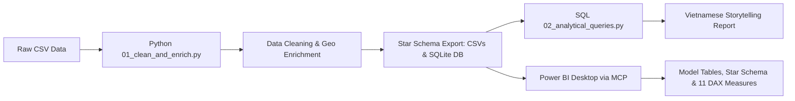

# DỰ ÁN PHÂN TÍCH DỮ LIỆU KHÁCH HÀNG OLIST (BRAZIL E-COMMERCE)

> **Vai trò**: Chuyên viên Phân tích Dữ liệu Cấp cao (Lead Data Analyst)  
> **Ngôn ngữ & Công nghệ**: Python 3.14 (Pandas, SQLite3), SQL, Power BI MCP, GitHub  
> **Tác giả**: [bnphongdata](https://github.com/bnphongdata)  
> **Kho lưu trữ GitHub**: [https://github.com/bnphongdata/Olist_Customers.git](https://github.com/bnphongdata/Olist_Customers.git)  

---

## 1. Cấu Trúc Thư Mục Dự Án (Project Architecture)

Dự án được tổ chức khoa học theo tiêu chuẩn phân tích dữ liệu chuyên nghiệp:

```
Olist_Customers/
├── data/
│   ├── raw/
│   │   └── olist_customers_dataset.csv     # Dữ liệu thô ban đầu (99,441 dòng)
│   ├── processed/
│   │   ├── olist_customers_clean.csv       # Bảng tổng hợp đã làm sạch & làm giàu
│   │   ├── dim_geography.csv               # Bảng chiều địa lý (Zip, City, State, Region)
│   │   ├── dim_customers.csv               # Bảng chiều khách hàng định danh (Unique)
│   │   └── fact_customer_orders.csv        # Bảng sự kiện giao dịch đơn hàng (Fact)
│   └── olist_analytics.db                  # Cơ sở dữ liệu SQLite tối ưu truy vấn
├── sql/
│   ├── 01_schema_and_views.sql             # DDL định nghĩa bảng, khóa chính/ngoại & views
│   └── 02_analytical_queries.sql           # Bộ 8 câu truy vấn phân tích kinh doanh có comment chi tiết
├── src/
│   ├── 01_clean_and_enrich.py              # Script Python tiền xử lý, chuẩn hóa, phân vùng IBGE & Star Schema
│   └── 02_run_sql_analytics.py             # Script thực thi SQL và xuất bảng phân tích nghiệp vụ
├── reports/
│   └── 01_data_storytelling_report.md      # Báo cáo Data Storytelling chuyên sâu bằng tiếng Việt
├── powerbi/
│   └── dax_measures_dictionary.md          # Từ điển thước đo DAX & Bản thiết kế Dashboard
├── LICENSE                                 # Giấy phép mã nguồn mở MIT
└── README.md                               # Hướng dẫn dự án toàn diện
```

---

## 2. Quy Trình Thực Hiện (Workflow)



### Bước 1: Làm sạch & Làm giàu Dữ liệu (Python & Pandas)
- Kiểm tra tính toàn vẹn (Data Quality Audit): Không có bản ghi NULL, không trùng lặp ID đơn hàng.
- Chuẩn hóa mã bưu điện (`customer_zip_code_prefix`) thành chuỗi 5 chữ số với padding số 0.
- Chuẩn hóa tên thành phố theo định dạng Title Case, mã bang viết hoa.
- **Data Enrichment**: Ánh xạ 27 bang vào 5 Đại vùng kinh tế Brazil theo chuẩn Viện Địa lý Thống kê IBGE (*Sudeste, Sul, Nordeste, Centro-Oeste, Norte*).
- **Feature Engineering**: Tính số lượng đơn hàng trên mỗi khách hàng (`order_count`) và phân loại phân khúc (`Khách hàng 1 lần`, `Khách quay lại 2-4 lần`, `Khách hàng VIP 5+ lần`).

### Bước 2: Phân Tích Chuyên Sâu Bằng SQL (SQLite3)
- Tạo bảng `dim_geography`, `dim_customers`, `fact_customer_orders` với chỉ mục tối ưu hóa hiệu năng.
- Thực thi bộ 8 câu hỏi phân tích kinh doanh chuyên sâu:
  1. *Quy mô tổng quan và Tỷ lệ khách hàng mua lại (Repeat Purchase Rate)*.
  2. *Phân khúc khách hàng theo mức độ gắn bó*.
  3. *Thị phần đơn hàng và mức độ phủ sóng trên 5 Đại vùng kinh tế*.
  4. *Quy luật Pareto 80/20 trên 27 bang của Brazil*.
  5. *Top 10 siêu đô thị có mật độ đơn hàng cao nhất*.
  6. *Hồ sơ khách hàng VIP (Top 1 đã mua 17 đơn hàng)*.
  7. *Mật độ đơn hàng trên từng mã bưu điện (Zip Code Density)*.
  8. *So sánh tỷ lệ mua lại giữa các bang đầu tàu*.

### Bước 3: Data Storytelling Bằng Tiếng Việt
- Báo cáo chi tiết tại [01_data_storytelling_report.md](file:///d:/Olist%20Customers/reports/01_data_storytelling_report.md).
- Bóc tách bài toán "Thùng thủng đáy" (**Leaky Bucket**): 96.88% khách hàng mua 1 lần rồi rời bỏ, chỉ 3.12% quay lại.
- Phân tích sự thống trị của vùng Đông Nam (**Sudeste chiếm 68.65% thị phần**), dẫn đầu là bang São Paulo (**SP: 41.98%**).
- Đề xuất chiến lược cải thiện tỷ lệ giữ chân khách hàng (Retention Strategy) và tối ưu hóa chuỗi cung ứng logistics chặng cuối.

### Bước 4: Xây Dựng Semantic Model & DAX Trên Power BI Qua MCP
- Sử dụng công cụ **Power BI MCP** kết nối trực tiếp đến ứng dụng Power BI Desktop đang mở.
- Nạp tự động 3 bảng chuẩn Star Schema:
  - `Fact_Customer_Orders` (99,441 dòng)
  - `Dim_Customers` (96,096 dòng)
  - `Dim_Geography` (14,994 dòng)
- Thiết lập quan hệ 1 - Nhiều (1-to-Many Relationships).
- Thiết lập Hierarchy địa lý: `Vùng Miền` -> `Bang` -> `Thành Phố`.
- Xây dựng bảng thước đo riêng `_ChiSo_KPI` gồm **11 DAX Measures** được phân theo từng thư mục hiển thị rõ ràng.

---

## 3. Các Chỉ Số Cốt Lõi (Key KPIs)

| Chỉ số (KPI) | Giá trị | Ý nghĩa |
| :--- | :---: | :--- |
| **Tổng đơn hàng** | **99,441** | Tổng số đơn hàng thành công |
| **Tổng khách hàng Unique** | **96,096** | Số người mua sắm cá nhân |
| **Khách hàng mua 1 lần** | **93,099 (96.88%)** | Tỷ lệ khách hàng mua rời rạc cực cao |
| **Khách hàng quay lại (>= 2 đơn)** | **2,997 (3.12%)** | Tỷ lệ mua lặp lại (Retention Rate) |
| **Khách hàng VIP (>= 5 đơn)** | **19** | Nhóm khách hàng trung thành nhất |
| **Khách hàng mua nhiều nhất** | **17 đơn** | Tại São Paulo |
| **Thị phần Vùng Đông Nam (Sudeste)** | **68.65%** | Cực tăng trưởng cốt lõi |
| **Thị phần Bang São Paulo (SP)** | **41.98%** | Đầu tàu thị trường |

---

## 4. Hướng Dẫn Chạy Dự Án

### Cài đặt môi trường:
```bash
pip install pandas tabulate
```

### Thực thi Pipeline làm sạch & tạo Database:
```bash
python src/01_clean_and_enrich.py
```

### Thực thi Báo cáo Phân tích SQL:
```bash
python src/02_run_sql_analytics.py
```
