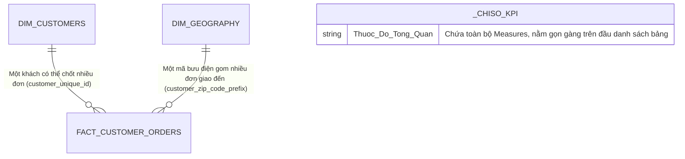

# HƯỚNG DẪN MÔ HÌNH HÓA & TỪ ĐIỂN DAX CHO DASHBOARD OLIST

> **Người thực hiện**: Bùi Nhất Phong (Data Analyst)  
> **Mục tiêu**: Giúp bạn hiểu rõ bản chất từng con số và cách bố trí Dashboard sao cho "biết nói", nhìn vào là thấy ngay vấn đề kinh doanh chứ không chỉ là những biểu đồ vô hồn.  
> **Trạng thái**: Đã nạp dữ liệu, thiết lập quan hệ và sẵn sàng trong mô hình Power BI Desktop.  

---

## 1. Bản Đồ Dữ Liệu (Star Schema Thực Chiến)

Thay vì nhồi nhét tất cả vào một bảng phẳng khổng lồ khiến Power BI ì ạch, chúng ta tách ra mô hình chuẩn hình ngôi sao (Star Schema):



- **`Fact_Customer_Orders` (Bảng Sự Kiện - 99.441 dòng)**: Nơi ghi lại từng lần shipper nhận lệnh giao hàng. Mỗi dòng là một lần khách bấm "Đặt Mua".
- **`Dim_Customers` (Bảng Khách Hàng - 96.096 người)**: Danh sách những con người thật bằng xương bằng thịt. Ở đây ta biết ai là khách ghé chơi 1 lần, ai là khách quen, và ai là "VIP chịu chi".
- **`Dim_Geography` (Bảng Địa Lý - 14.994 mã bưu điện)**: Bản đồ Brazil thu nhỏ, gắn từng mã zip vào thành phố, bang và 5 vùng kinh tế lớn.
- **`_ChiSo_KPI` (Bảng Thước Đo)**: Bảng chứa toàn bộ công thức DAX, đã được ẩn cột phụ để hiện biểu tượng chiếc máy tính (Calculator icon) ở đầu danh mục trường.

---

## 2. Giải Thích Ý Nghĩa Từng Thước Đo DAX (DAX Measures)

Mỗi thước đo sinh ra đều có một mục đích kinh doanh cụ thể, trả lời cho một câu hỏi thực tế:

### Thư mục 1: `01. Quy Mô & Sản Lượng` (Xem Olist bán được bao nhiêu)

#### 1. `[Tổng đơn hàng]`
- **Công thức**:
  ```dax
  Tổng đơn hàng = COUNTROWS(Fact_Customer_Orders)
  ```
- **Định dạng**: `#,##0` (Số nguyên, có dấu phẩy ngăn cách hàng nghìn)
- **Ý nghĩa thực tế**: Đếm xem trong suốt thời gian qua Olist đã xuất được bao nhiêu kiện hàng. Con số thực tế: **99.441 đơn**.

#### 2. `[Tổng khách hàng Unique]`
- **Công thức**:
  ```dax
  Tổng khách hàng Unique = DISTINCTCOUNT(Dim_Customers[customer_unique_id])
  ```
- **Định dạng**: `#,##0`
- **Ý nghĩa thực tế**: Đếm số người thật đã từng rút ví. Lưu ý: Không được đếm cột `customer_id` vì mỗi đơn Olist lại sinh ra một mã mới, đếm thế sẽ bị trùng. Con số thực tế: **96.096 người**.

#### 3. `[Tần suất mua TB (Đơn/Khách)]`
- **Công thức**:
  ```dax
  Tần suất mua TB (Đơn/Khách) = DIVIDE([Tổng đơn hàng], [Tổng khách hàng Unique], 0)
  ```
- **Định dạng**: `0.000`
- **Ý nghĩa thực tế**: Lấy tổng số đơn chia cho tổng số người. Con số thực tế đạt **1.035 đơn/khách** – một con số "báo động" cho thấy hầu như khách chỉ ghé qua đúng 1 lần rồi thôi!

---

### Thư mục 2: `02. Giữ Chân & Khách Hàng Thân Thiết` (Xem khách có yêu Olist không)

#### 4. `[Khách hàng mua 1 lần]`
- **Công thức**:
  ```dax
  Khách hàng mua 1 lần = 
  CALCULATE(
      DISTINCTCOUNT(Fact_Customer_Orders[customer_unique_id]), 
      Dim_Customers[order_count] = 1
  )
  ```
- **Định dạng**: `#,##0`
- **Ý nghĩa thực tế**: Tệp khách hàng "vãng lai", mua một lần xong rồi biến mất. Chiếm tới **93.099 người (96.88%)**. Đây là lượng khách đang bị rò rỉ khỏi phễu bán hàng.

#### 5. `[Khách hàng quay lại (>=2 đơn)]`
- **Công thức**:
  ```dax
  Khách hàng quay lại (>=2 đơn) = 
  CALCULATE(
      DISTINCTCOUNT(Fact_Customer_Orders[customer_unique_id]), 
      Dim_Customers[order_count] > 1
  )
  ```
- **Định dạng**: `#,##0`
- **Ý nghĩa thực tế**: Những vị khách chịu quay lại mở ví lần 2, lần 3... Chỉ vỏn vẹn **2.997 người**.

#### 6. `[Tỷ lệ mua lại (%)]`
- **Công thức**:
  ```dax
  Tỷ lệ mua lại (%) = DIVIDE([Khách hàng quay lại (>=2 đơn)], [Tổng khách hàng Unique], 0)
  ```
- **Định dạng**: `0.00%`
- **Ý nghĩa thực tế**: Trọng tài chấm điểm mức độ trung thành của khách hàng đối với sàn Olist. Đạt **3.12%**. Trong ngành TMĐT, tỷ lệ này thông thường phải đạt từ 15% đến 25% thì công ty mới có lãi bền vững.

#### 7. `[Khách hàng VIP (>=5 đơn)]`
- **Công thức**:
  ```dax
  Khách hàng VIP (>=5 đơn) = 
  CALCULATE(
      DISTINCTCOUNT(Fact_Customer_Orders[customer_unique_id]), 
      Dim_Customers[order_count] >= 5
  )
  ```
- **Định dạng**: `#,##0`
- **Ý nghĩa thực tế**: Những "fan cứng" mua từ 5 đơn trở lên. Toàn sàn chỉ có đúng **19 người**. Cần có đội ngũ chăm sóc khách hàng gọi điện trực tiếp cảm ơn và phỏng vấn xem điều gì khiến họ yêu thích Olist.

---

### Thư mục 3: `03. Phân Tích Địa Lý & Vùng Miền` (Hàng hóa đang chảy về đâu)

#### 8. `[Số đô thị có đơn hàng]`
- **Công thức**:
  ```dax
  Số đô thị có đơn hàng = DISTINCTCOUNT(Dim_Geography[customer_city])
  ```
- **Ý nghĩa thực tế**: Phủ sóng tới **4.100 thành phố**, chứng tỏ thương hiệu Olist có độ nhận biết rất rộng trên toàn cõi Brazil.

#### 9. `[Số bang phủ sóng]`
- **Công thức**:
  ```dax
  Số bang phủ sóng = DISTINCTCOUNT(Dim_Geography[customer_state])
  ```
- **Ý nghĩa thực tế**: **27/27 bang**, không bỏ sót bất kỳ bang nào từ Bắc chí Nam.

#### 10. `[Đơn hàng Vùng Đông Nam]`
- **Công thức**:
  ```dax
  Đơn hàng Vùng Đông Nam = CALCULATE([Tổng đơn hàng], Dim_Geography[region_code] = "Sudeste")
  ```
- **Ý nghĩa thực tế**: Riêng vùng kinh tế Đông Nam (São Paulo, Rio, Minas Gerais, Espírito Santo) đã "nuốt trọn" **68.266 đơn hàng** (hơn 68.6% toàn quốc).

#### 11. `[% Tỷ trọng Đơn hàng Vùng]`
- **Công thức**:
  ```dax
  % Tỷ trọng Đơn hàng Vùng = 
  DIVIDE(
      [Tổng đơn hàng], 
      CALCULATE([Tổng đơn hàng], ALLSELECTED(Fact_Customer_Orders)), 
      0
  )
  ```
- **Ý nghĩa thực tế**: Giúp biểu đồ Donut Chart hoặc Bar Chart tự động tính % thị phần của từng vùng khi người dùng bấm lọc.

---

## 3. Gợi Ý Bố Trí Dashboard Kể Chuyện (Storytelling Layout)

Để Dashboard của bạn nhìn vào có "hồn" và cuốn hút người xem như đang đọc một bài báo kinh doanh, hãy chia làm 3 trang:

### Trang 1: "Bức tranh toàn cảnh: Tăng trưởng nóng nhưng thùng thủng đáy"
- **Dải Card KPI trên đầu**: Đặt 4 thẻ Card lớn:
  1. `[Tổng đơn hàng]`: **99.441**
  2. `[Tổng khách hàng Unique]`: **96.096**
  3. `[Tỷ lệ mua lại (%)]`: **3.12%** (Tô màu cảnh báo vàng/cam nhẹ để nhấn mạnh vấn đề)
  4. `[Số đô thị phủ sóng]`: **4.100**
- **Biểu đồ Vành khăn (Donut Chart)**: Cơ cấu đơn hàng theo 5 vùng kinh tế. Cho người xem thấy Vùng Đông Nam áp đảo tới 68.6%.
- **Biểu đồ Cột ngang (Bar Chart)**: Top 10 bang theo số đơn. Làm nổi bật 3 bang đầu tàu: São Paulo (SP), Rio (RJ) và Minas Gerais (MG).

### Trang 2: "Điểm nghẽn giữ chân: Vì sao khách chỉ đến một lần?"
- **Biểu đồ Cột chồng 100% (100% Stacked Bar)**:
  - Trục Y: Top 10 bang lớn.
  - Phân loại (Legend): `customer_segment` (Khách 1 lần vs Khách quay lại).
  - Mục đích: Cho thấy dù ở bang giàu như São Paulo hay bang xa như Bahia, tỷ lệ khách 1 lần vẫn chiếm tới 96%.
- **Bảng Vinh Danh Khách VIP (Table Visual)**:
  - Hiển thị danh sách 19 vị khách mua >= 5 lần.
  - Nêu bật vị khách quán quân chốt **17 đơn** tại São Paulo để làm case-study điển hình.

### Trang 3: "Bản đồ chiến lược Logistics & Cơ hội mở rộng"
- **Bản đồ nhiệt (Filled Map / Shape Map)**:
  - Vị trí: `customer_state`.
  - Màu sắc: `[Tổng đơn hàng]`. Đậm đặc ở vùng Đông Nam và nhạt dần về phía Bắc.
- **Tính năng Khoan sâu (Drill-down)**:
  - Kéo trường phân cấp `Phân Cấp Địa Lý` vào visual để khi người dùng click đúp vào "Sudeste" (Đông Nam), nó tự mở ra các bang (SP, RJ, MG), và click tiếp sẽ mở ra từng thành phố cụ thể.
