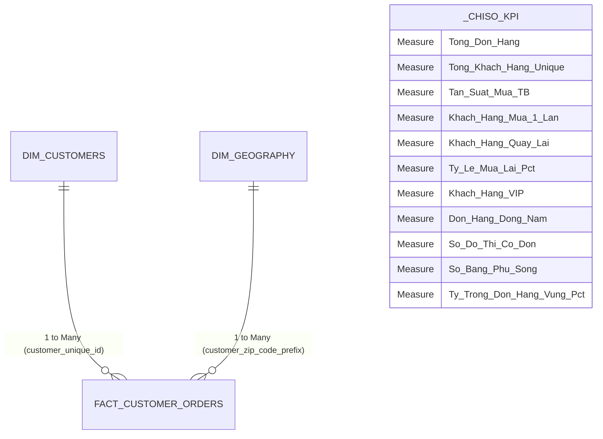

# TỪ ĐIỂN DAX MEASURES & THIẾT KẾ DASHBOARD POWER BI CHO OLIST

> **Dự án**: Phân tích Dữ liệu Khách hàng Olist (Brazil E-Commerce)  
> **Tác giả**: Chuyên viên Phân tích Dữ liệu Cấp cao (Lead Data Analyst)  
> **Mô hình**: Star Schema (`Fact_Customer_Orders`, `Dim_Customers`, `Dim_Geography`, `_ChiSo_KPI`)  
> **Trạng thái**: Đã kết nối và triển khai trực tiếp vào Power BI Desktop qua Power BI MCP  

---

## 1. Kiến Trúc Mô Hình Dữ Liệu (Semantic Model Architecture)



---

## 2. Danh Mục Thước Đo DAX (DAX Measures Catalog)

### Thư mục hiển thị: `01. Quy Mô & Sản Lượng`

#### 1. `[Tổng đơn hàng]`
- **Công thức DAX**:
  ```dax
  Tổng đơn hàng = COUNTROWS(Fact_Customer_Orders)
  ```
- **Định dạng**: `#,##0` (Số nguyên phân cách hàng nghìn)
- **Ý nghĩa**: Đo lường tổng khối lượng giao dịch phát sinh trên toàn hệ thống sàn Olist.

#### 2. `[Tổng khách hàng Unique]`
- **Công thức DAX**:
  ```dax
  Tổng khách hàng Unique = DISTINCTCOUNT(Dim_Customers[customer_unique_id])
  ```
- **Định dạng**: `#,##0`
- **Ý nghĩa**: Đếm chính xác số lượng thực thể người mua sắm con người (Human Customers) đã đăng ký.

#### 3. `[Tần suất mua TB (Đơn/Khách)]`
- **Công thức DAX**:
  ```dax
  Tần suất mua TB (Đơn/Khách) = DIVIDE([Tổng đơn hàng], [Tổng khách hàng Unique], 0)
  ```
- **Định dạng**: `0.000`
- **Ý nghĩa**: Tần suất giao dịch bình quân. Giá trị đạt `1.035`, phản ánh đa số người dùng chỉ mua duy nhất 1 lần.

---

### Thư mục hiển thị: `02. Giữ Chân & Khách Hàng Thân Thiết`

#### 4. `[Khách hàng mua 1 lần]`
- **Công thức DAX**:
  ```dax
  Khách hàng mua 1 lần = 
  CALCULATE(
      DISTINCTCOUNT(Fact_Customer_Orders[customer_unique_id]), 
      Dim_Customers[order_count] = 1
  )
  ```
- **Định dạng**: `#,##0`
- **Ý nghĩa**: Số lượng người mua một lần rồi rời bỏ (One-time Churn risk). Đạt **93,099 người (96.88%)**.

#### 5. `[Khách hàng quay lại (>=2 đơn)]`
- **Công thức DAX**:
  ```dax
  Khách hàng quay lại (>=2 đơn) = 
  CALCULATE(
      DISTINCTCOUNT(Fact_Customer_Orders[customer_unique_id]), 
      Dim_Customers[order_count] > 1
  )
  ```
- **Định dạng**: `#,##0`
- **Ý nghĩa**: Tệp khách hàng đã phát sinh từ đơn thứ hai trở đi (Repeat/Returning Customers). Đạt **2,997 người**.

#### 6. `[Tỷ lệ mua lại (%)]`
- **Công thức DAX**:
  ```dax
  Tỷ lệ mua lại (%) = DIVIDE([Khách hàng quay lại (>=2 đơn)], [Tổng khách hàng Unique], 0)
  ```
- **Định dạng**: `0.00%`
- **Ý nghĩa**: Chỉ số cốt lõi đánh giá mức độ gắn bó (Customer Retention). Đạt **3.12%**.

#### 7. `[Khách hàng VIP (>=5 đơn)]`
- **Công thức DAX**:
  ```dax
  Khách hàng VIP (>=5 đơn) = 
  CALCULATE(
      DISTINCTCOUNT(Fact_Customer_Orders[customer_unique_id]), 
      Dim_Customers[order_count] >= 5
  )
  ```
- **Định dạng**: `#,##0`
- **Ý nghĩa**: Số lượng khách hàng trung thành cấp cao nhất. Hiện có **19 khách hàng**.

---

### Thư mục hiển thị: `03. Phân Tích Địa Lý & Vùng Miền`

#### 8. `[Số đô thị có đơn hàng]`
- **Công thức DAX**:
  ```dax
  Số đô thị có đơn hàng = DISTINCTCOUNT(Dim_Geography[customer_city])
  ```
- **Định dạng**: `#,##0`
- **Ý nghĩa**: Độ phủ thị trường đô thị toàn quốc (**4,100 thành phố**).

#### 9. `[Số bang phủ sóng]`
- **Công thức DAX**:
  ```dax
  Số bang phủ sóng = DISTINCTCOUNT(Dim_Geography[customer_state])
  ```
- **Định dạng**: `#,##0`
- **Ý nghĩa**: Độ phủ hành chính (**27/27 bang** của Brazil).

#### 10. `[Đơn hàng Vùng Đông Nam]`
- **Công thức DAX**:
  ```dax
  Đơn hàng Vùng Đông Nam = CALCULATE([Tổng đơn hàng], Dim_Geography[region_code] = "Sudeste")
  ```
- **Định dạng**: `#,##0`
- **Ý nghĩa**: Số đơn hàng tại vùng kinh tế chủ lực (**68,266 đơn**).

#### 11. `[% Tỷ trọng Đơn hàng Vùng]`
- **Công thức DAX**:
  ```dax
  % Tỷ trọng Đơn hàng Vùng = 
  DIVIDE(
      [Tổng đơn hàng], 
      CALCULATE([Tổng đơn hàng], ALLSELECTED(Fact_Customer_Orders)), 
      0
  )
  ```
- **Định dạng**: `0.00%`

---

## 3. Bản Thiết Kế Trực Quan Hóa Dashboard (Dashboard Layout Wireframe)

### Trang 1: Executive Overview (Tổng Quan Điều Hành)
- **Hàng Card KPI trên cùng**:
  1. `[Tổng đơn hàng]`: **99,441**
  2. `[Tổng khách hàng Unique]`: **96,096**
  3. `[Tỷ lệ mua lại (%)]`: **3.12%**
  4. `[Số đô thị có đơn]`: **4,100**
- **Biểu đồ Cột ngang (Bar Chart)**: *Top 10 Bang theo Sản Lượng Đơn Hàng* (`Dim_Geography[customer_state]` vs `[Tổng đơn hàng]`).
- **Biểu đồ Tròn/Vành khăn (Donut Chart)**: *Cơ cấu Thị phần theo 5 Vùng Kinh Tế* (`Dim_Geography[region_name]` vs `[Tổng đơn hàng]`).
- **Bộ Lọc (Slicers)**:
  - Vùng miền (`Dim_Geography[region_name]`)
  - Phân khúc khách hàng (`Fact_Customer_Orders[customer_segment]`)

### Trang 2: Customer Retention Deep-Dive (Phân Tích Chiều Sâu Giữ Chân)
- **Biểu đồ Cột Chồng (100% Stacked Bar Chart)**: *Tỷ trọng Khách hàng 1 lần vs Khách mua lại theo từng Bang*.
- **Bảng Chi Tiết (Matrix Visual)**:
  - Hàng: `customer_segment` -> `order_count`
  - Giá trị: Số khách hàng, Tổng đơn hàng, Tỷ lệ đóng góp %.
- **Thẻ Điểm (Scorecard)**: Khách hàng đạt kỷ lục mua nhiều nhất (**17 đơn hàng** tại São Paulo).

### Trang 3: Geographic & Logistics Intelligence (Bản Đồ Địa Lý & Vận Tải)
- **Biểu đồ Bản đồ (Shape Map / Filled Map)**:
  - Vị trí: `Dim_Geography[customer_state]`
  - Độ đậm nhạt (Color Saturation): `[Tổng đơn hàng]`
- **Phân cấp Khoan sâu (Drill-down Hierarchy)**:
  - Sử dụng Hierarchy `Phân Cấp Địa Lý`: `Vùng Miền` -> `Bang` -> `Thành Phố`.
