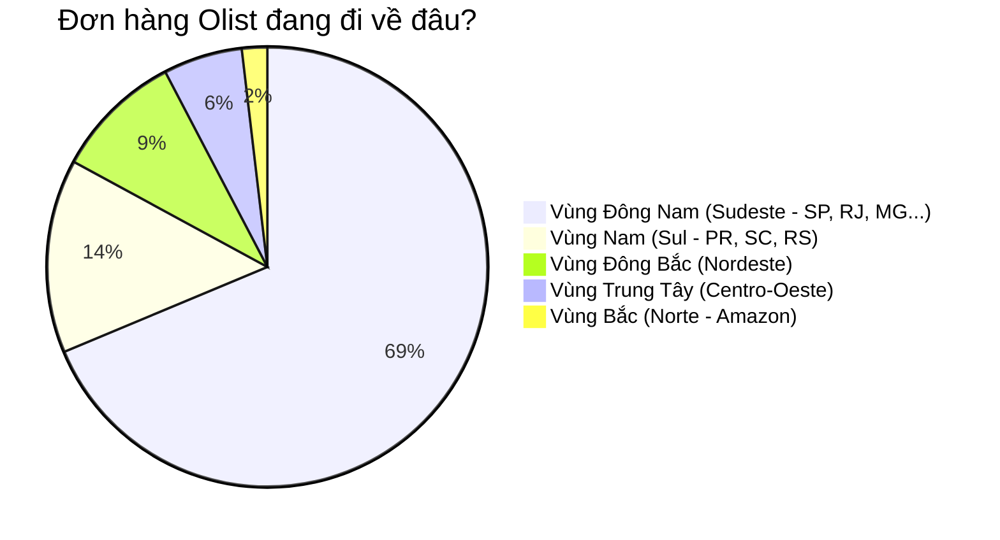

# ĐẰNG SAU 100.000 ĐƠN HÀNG: OLIST ĐANG BÁN HÀNG CHO AI VÀ VÌ SAO KHÁCH KHÔNG QUAY LẠI?

> **Người viết**: Bùi Nhất Phong (Data Analyst)  
> **Dữ liệu phân tích**: Gần 100.000 giao dịch khách hàng Olist (Thương mại điện tử Brazil)  
> **Góc nhìn**: Câu chuyện thực tế từ số liệu – Không màu mè, đi thẳng vào bản chất kinh doanh  

---

## Mở đầu: Khi những con số đẹp che giấu một thực tế đáng lo

Nếu chỉ nhìn lướt qua bảng báo cáo cuối năm gửi cho các nhà đầu tư, Olist trông giống như một câu chuyện thành công rực rỡ:
- Gần **100.000 đơn hàng** (chính xác là 99.441 đơn).
- Phủ sóng khắp **4.119 thành phố lớn nhỏ**, cắm cờ trên toàn bộ **27 bang** của đất nước Brazil rộng lớn.
- Hơn **96.000 người tiêu dùng** đã từng mở ví trả tiền trên nền tảng.

Thoạt nhìn, đó là tốc độ tăng trưởng quy mô (Scale) mà bất kỳ sàn thương mại điện tử nào cũng thèm muốn. Nhưng khi một người làm dữ liệu ngồi xuống, bóc tách từng lớp bảng biểu và đặt câu hỏi: *"Khách hàng của chúng ta thực sự là ai? Họ có yêu thích Olist không? Họ có quay lại không?"*, một sự thật trần trụi và khá "đau đớn" bắt đầu lộ diện.

---

## Chương 1: "Tình một đêm" trong thương mại điện tử – Căn bệnh chiếc thùng thủng đáy

Con số đầu tiên khiến tôi giật mình không phải là tổng đơn hàng, mà là con số này: **3,12%**.

```
[ Tổng số khách hàng: 96.096 người ]
  ├── 93.099 người (96,88%) ──> Mua đúng 1 lần rồi "biến mất không dấu vết"
  └──  2.997 người ( 3,12%) ──> Có quay lại mua từ lần thứ 2 trở lên
```

Hãy thử hình dung: Bạn mở một cửa hàng mặt phố, ngày nào cũng có cả nghìn lượt khách ghé qua mua đồ. Nhưng cứ 100 người bước ra khỏi cửa, thì có tới **97 người một đi không trở lại**.

Trong ngành bán lẻ và E-commerce, người ta gọi đây là hiện tượng **"Chiếc thùng thủng đáy" (Leaky Bucket)**. Đội ngũ Marketing đang phải gồng mình chạy quảng cáo, đổ tiền vào Google, Facebook, hợp tác với các sàn lớn như Mercado Livre để kéo từng lượt khách mới về. Nhưng bao nhiêu nước đổ vào thùng thì đáy thùng lại rò rỉ bấy nhiêu:
- Tần suất mua trung bình toàn sàn chỉ vỏn vẹn **1,03 đơn/khách**. Tức là gần như không có sự gắn kết.
- Người tiêu dùng không hề nhớ Olist là ai. Họ chỉ nhớ họ vừa mua một cái chảo hay đôi giày trên Mercado Livre, còn Olist chỉ là cái tên mờ nhạt in trên nhãn bọc hàng.

> **Bài học rút ra**: Tăng trưởng nhờ "đốt tiền" tìm khách mới (High CAC) mà không giữ chân được họ (Low Retention) là con đường ngắn nhất dẫn đến kiệt sức về dòng tiền.

---

## Chương 2: Một quốc gia, hai thế giới – Trọng tâm lệch pha của xứ sở Samba

Brazil là đất nước rộng mênh mông, nhưng thị trường của Olist thì lại thu bé lại vừa bằng một góc:



Nhìn vào bản đồ phân bổ đơn hàng, bạn sẽ thấy rõ sự bất đối xứng đến nghẹt thở:

1. **"Gia tộc Đông Nam" gánh cả sàn Olist**:
   - Vùng Đông Nam (Sudeste) chiếm gần **69% toàn bộ đơn hàng**.
   - Riêng 3 bang **São Paulo (SP)**, **Rio de Janeiro (RJ)**, và **Minas Gerais (MG)** đã nuốt trọn **66,6%** thị phần.
   - Đặc biệt, riêng bang São Paulo đã là **41,98%**. Nghĩa là cứ 10 kiện hàng shipper Olist giao đi, thì hơn 4 kiện chạy vòng quanh bang São Paulo.

2. **Tại sao vùng Bắc và Đông Bắc lại "im hơi lặng tiếng"?**:
   - Vùng Bắc (Norte) – nơi có rừng rậm Amazon – rộng bạt ngàn nhưng chỉ đóng góp vỏn vẹn **1,86% đơn hàng**.
   - Không phải người dân ở Manaus hay Belém không thích mua sắm online, mà vì **logistics là một cơn ác mộng**. Một kiện hàng chuyển từ kho ở São Paulo lên miền Bắc có thể mất 2 đến 3 tuần lễ, phí ship nhiều khi đắt hơn cả giá trị món đồ. Khách hàng bấm vào xem giỏ hàng, nhìn thấy tiền ship và ngày nhận dự kiến là họ lập tức bỏ đi.

---

## Chương 3: Đi tìm những người "chịu chi" – Chân dung 19 khách hàng VIP

Giữa đại dương 93.000 khách hàng mua một lần rồi thôi, vẫn có những điểm sáng le lói khiến tôi tò mò: **19 vị khách siêu trung thành** đã đặt từ 5 đơn hàng trở lên.

Họ là ai?
- **Quán quân mua sắm**: Mã khách hàng `8d50f5ea...` sống ngay tại trung tâm thành phố **São Paulo**, đã đặt tổng cộng **17 đơn hàng**!
- **Á quân**: Một khách hàng tại thành phố biển **Praia Grande (bang SP)** với **9 đơn hàng**.
- Nhìn vào danh sách Top 10 khách mua nhiều nhất, có một điểm chung rõ rệt: **Hầu hết họ đều sống ở São Paulo và Rio de Janeiro**.

Tại sao họ lại mua nhiều lần như vậy? Đơn giản vì họ ở ngay "thủ phủ" kho vận. Đặt hàng hôm trước, hôm sau đã có shipper gõ cửa. Trải nghiệm mượt mà, cước phí rẻ khiến họ an tâm mua đi mua lại. 

Điều này chứng minh một chân lý sống còn: **Trong E-commerce, trải nghiệm giao nhận (Logistics CX) chính là công cụ tiếp thị giữ chân khách tốt nhất, hơn mọi lời quảng cáo hoa mỹ.**

---

## Chương 4: Chúng ta nên làm gì từ ngày mai? (Gợi ý cho Ban Giám Đốc)

Thay vì tiếp tục vung tiền mở rộng quy mô một cách mù quáng, Olist cần chuyển mình từ tư duy "săn bắt" (Acquisition) sang tư duy "chăn nuôi" (Retention):

### 1. Phải vá chiếc thùng đáy thủng ngay lập tức
- **Chiến dịch "Cú hích đơn hàng thứ 2"**: Thống kê cho thấy rào cản khó nhất là biến khách hàng từ lần 1 sang lần 2. Hãy tự động gửi một voucher miễn phí vận chuyển hoặc giảm 10% cho đơn tiếp theo đúng vào ngày thứ 3 sau khi họ vừa nhận được món hàng đầu tiên. Lúc đó niềm vui mở hộp vẫn còn tươi mới.
- **Xây dựng nhận diện thương hiệu trong gói hàng**: Người ta mua trên Mercado Livre nhưng do Olist đóng gói. Đừng để hộp hàng chỉ là một thùng carton nâu vô danh. Hãy kèm theo một tấm thiệp cảm ơn chỉn chu, một mã QR tích điểm thành viên Olist để kéo họ về website hoặc ứng dụng riêng của mình.

### 2. Tối ưu theo chiều sâu vùng Đông Nam thay vì dàn trải
- São Paulo và Rio de Janeiro đang có mật độ đơn hàng cực kỳ dày đặc (7 đến 10 đơn trên mỗi mã bưu điện). Hãy bắt tay với các đơn vị vận chuyển địa phương để ra mắt gói **"Giao hàng trong 24 giờ" (Next-day Delivery)** tại 2 thành phố này. Đây là vũ khí tối thượng để cạnh tranh với các đối thủ lớn.

### 3. Giải bài toán miền Đông Bắc bằng "Kho hàng vệ tinh"
- Vùng Đông Bắc (Nordeste) có tới gần 10.000 đơn hàng dù phí ship cao. Đây là một thị trường đang khát hàng hóa giá tốt. Nếu Olist dám đặt một kho hoàn tất đơn hàng (Fulfillment Hub) ở Salvador hoặc Recife để lưu trữ sẵn các mặt hàng bán chạy nhất (Top SKU), thời gian giao hàng tại đây sẽ giảm từ 15 ngày xuống còn 2-3 ngày. Đó sẽ là cú hích doanh số bùng nổ tiếp theo.

---

## Lời kết của một Data Analyst

Dữ liệu không chỉ là những con số vô tri trên màn hình vi tính hay các biểu đồ đẹp mắt trên Power BI. Đằng sau mỗi dòng dữ liệu là một con người thật: một bà mẹ ở São Paulo mua tã cho con, một chàng thanh niên ở Bahia đang hồi hộp đợi đôi giày mới.

Olist đã làm rất tốt việc phủ sóng thương hiệu ra khắp xứ sở Samba. Nhưng để đi được đường dài và tạo ra lợi nhuận bền vững, đã đến lúc Olist phải học cách trân trọng từng người khách cũ, biến những vị khách vãng lai mua một lần thành những người bạn đồng hành dài lâu.
