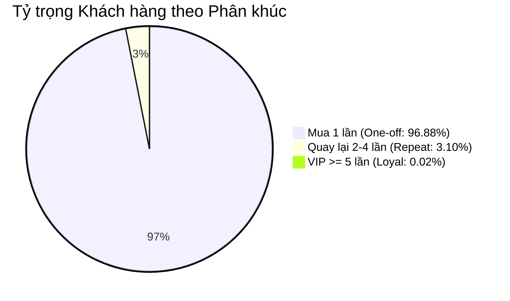

# BÁO CÁO PHÂN TÍCH DỮ LIỆU & STORYTELLING: BÀI TOÁN TĂNG TRƯỞNG & GIỮ CHÂN KHÁCH HÀNG OLIST (BRAZIL)

> **Người thực hiện**: Chuyên viên Phân tích Dữ liệu Cấp cao (Lead Data Analyst)  
> **Bộ dữ liệu**: `Olist Customers Dataset` (99,441 giao dịch đơn hàng)  
> **Công cụ**: Python 3.14 (Pandas, SQLite3), SQL Analytics, Power BI MCP  
> **Thời gian thực hiện**: Tháng 10/2026  

---

## Executive Summary (Tóm Tắt Điều Hành)

Sau khi làm sạch, chuẩn hóa và mô hình hóa toàn bộ 99,441 bản ghi khách hàng của sàn thương mại điện tử Olist tại Brazil, đội ngũ Data Analyst đã bóc tách được bức tranh toàn cảnh về hành vi người tiêu dùng, cơ cấu địa lý và những điểm nghẽn tăng trưởng cốt tử:

1. **Quy mô ấn tượng nhưng "Đói" lòng trung thành (Retention Crisis)**:
   - Sàn đã phục vụ **96,096 khách hàng định danh duy nhất (Unique Customers)** với **99,441 đơn hàng** tại **4,119 thành phố** thuộc toàn bộ 27 bang của Brazil.
   - Tuy nhiên, có tới **96.88% khách hàng chỉ mua duy nhất 1 lần (93,099 người)**. Tỷ lệ mua lặp lại (**Repeat Purchase Rate**) chỉ đạt vỏn vẹn **3.12% (2,997 người)**. Tần suất mua trung bình toàn sàn là **1.035 đơn/khách**.
   - *Hệ quả*: Olist đang tiêu tốn chi phí thu hút khách hàng mới (**Customer Acquisition Cost - CAC**) rất lớn nhưng chưa khai thác được giá trị vòng đời khách hàng (**Customer Lifetime Value - CLV**).

2. **Cực tăng trưởng kinh tế lệch pha – Nguyên lý Pareto 80/20**:
   - Vùng **Đông Nam (Sudeste)** chiếm áp đảo **68.65% sản lượng đơn hàng** (68,266 đơn), kế tiếp là Vùng **Nam (Sul)** với **14.23%**. Hai vùng này gộp lại chiếm tới gần **83%** thị phần toàn quốc.
   - Riêng **Top 3 bang (SP, RJ, MG)** đã tạo ra **66.6%** tổng số đơn hàng. Riêng bang **São Paulo (SP)** chiếm **41.98%**.
   - Ngược lại, hai vùng rộng lớn là **Đông Bắc (Nordeste)** và **Bắc (Norte)** chỉ chiếm lần lượt **9.40%** và **1.86%**, phản ánh rào cản rất lớn về logistics và thời gian giao hàng.

3. **Mật độ đô thị và Lợi thế giao vận chặng cuối (Last-Mile Logistics)**:
   - Siêu đô thị **São Paulo** là trung tâm tiêu thụ số 1 với **15,540 đơn hàng (15.63% cả nước)**, theo sau là **Rio de Janeiro** với **6,882 đơn hàng (6.92%)**.
   - Mật độ đơn hàng trên mỗi mã bưu điện tại bang RJ (10.72 đơn/zip) và SP (7.47 đơn/zip) mở ra cơ hội tối ưu hóa mô hình kho gom tập trung (Micro-Fulfillment Centers) và giao hàng trong ngày (Same-day Delivery).

---

## Bảng Chỉ Số Hiệu Suất Cốt Lõi (Key Performance Indicators)

| Chỉ số (KPI) | Giá trị thực tế | Nhận xét chuyên môn |
| :--- | :---: | :--- |
| **Tổng số giao dịch (Total Orders)** | **99,441** | Khối lượng dữ liệu giao dịch toàn diện |
| **Khách hàng định danh (Unique Customers)** | **96,096** | Cơ sở người dùng đã đăng ký mua sắm |
| **Khách hàng mua 1 lần (One-off Buyers)** | **93,099 (96.88%)** | Chiếm tỷ trọng áp đảo, nguy cơ rời bỏ cao |
| **Khách hàng quay lại (Repeat Buyers >= 2)** | **2,997 (3.12%)** | Điểm nghẽn lớn nhất của mô hình kinh doanh |
| **Khách hàng siêu trung thành (VIP >= 5)** | **19 khách** | Khách mua cao nhất: 17 đơn hàng (São Paulo) |
| **Số đô thị phủ sóng (Cities Served)** | **4,119** | Phủ rộng khắp 27/27 bang Brazil |
| **Thị phần Vùng Đông Nam (Sudeste)** | **68.65%** | Thị trường hạt nhân sinh lời chính |
| **Thị phần Bang São Paulo (SP)** | **41.98%** | Đầu tàu kinh tế số 1 của Olist |

---

## Câu Chuyện Dữ Liệu (The Data Story)



### Hồi 1: Căn bệnh "Chảy máu khách hàng" (The Leaky Bucket Dilemma)
Trong lý thuyết thương mại điện tử hiện đại, một nền tảng khỏe mạnh thường duy trì tỷ lệ khách hàng quay lại (Repeat Rate) từ **20% đến 40%**. 

Dữ liệu Olist phản ánh hiện tượng chiếc thùng thủng đáy (**Leaky Bucket**):
- Cứ 100 người lên sàn Olist mua sắm thì có tới **gần 97 người "một đi không trở lại"**.
- Chỉ có vỏn vẹn **3.12%** khách hàng phát sinh đơn hàng thứ hai.
- **Nguyên nhân tiềm ẩn**: Olist hoạt động như một giải pháp tích hợp (Aggregator/Enabler) bán hàng đa kênh trên các sàn như Mercado Livre, B2W, Amazon. Người tiêu dùng mua hàng thường nhớ đến tên sàn marketplace lớn hơn là thương hiệu Olist. Bên cạnh đó, thời gian giao hàng liên bang tại Brazil thường kéo dài (từ 10 đến 25 ngày) cùng phí ship cao là rào cản tâm lý cực lớn ngăn cản họ quay lại.

---

### Hồi 2: Sự phân hóa địa lý Đông Nam - Bắc (The Regional Divide)

Brazil là quốc gia có diện tích rộng lớn thứ 5 thế giới, và sự bất đối xứng kinh tế thể hiện triệt để trong cơ cấu đơn hàng của Olist:

```
┌────────────────────────────────────────────────────────────────────────┐
│                      PHÂN BỔ ĐƠN HÀNG THEO 5 VÙNG                      │
├─────────────────────────┬──────────────┬──────────────┬────────────────┤
│ Vùng Kinh Tế            │ Số đơn hàng  │  Thị phần %  │ Số đô thị      │
├─────────────────────────┼──────────────┼──────────────┼────────────────┤
│ Sudeste (Đông Nam)      │    68,266    │    68.65%    │     1,749      │
│ Sul (Nam)               │    14,148    │    14.23%    │     1,170      │
│ Nordeste (Đông Bắc)     │     9,400    │     9.40%    │       794      │
│ Centro-Oeste (Trung Tây)│     5,772    │     5.80%    │       265      │
│ Norte (Bắc)             │     1,855    │     1.86%    │       141      │
└─────────────────────────┴──────────────┴──────────────┴────────────────┘
```

- **Sudeste (Đông Nam)** là "trái tim" của Olist, tập trung bộ ba quyền lực **São Paulo (SP - 41.98%)**, **Rio de Janeiro (RJ - 12.92%)**, và **Minas Gerais (MG - 11.70%)**. Nơi đây có cơ sở hạ tầng giao thông đồng bộ, thu nhập bình quân đầu người cao và thời gian giao hàng ngắn.
- **Norte (Bắc)** dù chiếm tới 45% diện tích lãnh thổ Brazil nhưng chỉ đóng góp **1.86%** đơn hàng. Địa hình rừng rậm Amazon và mạng lưới đường bộ hạn chế khiến logistics đường hàng không và đường thủy có chi phí quá đắt đỏ so với giá trị món hàng.

---

### Hồi 3: Top Siêu Đô Thị – Nơi Quyết Định Cuộc Chơi

Khi đào sâu vào cấp độ thành phố:
1. **São Paulo** vượt trội hoàn toàn với **15,540 đơn**, gấp 2.25 lần đối thủ bám đuổi là **Rio de Janeiro** (6,882 đơn).
2. Top 10 thành phố lớn nhất chiếm gần **36%** tổng số đơn hàng toàn quốc.
3. Mật độ mã bưu điện tại São Paulo phủ rộng tới **2,843 mã zip**, chứng minh sức lan tỏa từ khu vực trung tâm (Paulista, Jardins) cho đến các khu vực vành đai ngoại ô.

```
+ Top 1: Sao Paulo (SP)        - 15,540 đơn (15.63%)
+ Top 2: Rio De Janeiro (RJ)   -  6,882 đơn ( 6.92%)
+ Top 3: Belo Horizonte (MG)   -  2,773 đơn ( 2.79%)
+ Top 4: Brasilia (DF)         -  2,131 đơn ( 2.14%)
+ Top 5: Curitiba (PR)         -  1,521 đơn ( 1.53%)
```

---

### Hồi 4: Chân dung Khách hàng VIP – Những hạt giống vàng

Dù số lượng ít ỏi (chỉ 19 người có từ 5 đơn trở lên), nhóm khách hàng này có giá trị nghiên cứu đặc biệt:
- **Khách hàng quán quân**: Mã ID `8d50f5eadf50201ccdcedfb9e2ac8455` tại São Paulo đã đặt tới **17 đơn hàng**.
- **Khách hàng thứ hai**: Mã ID `3e43e6105506432c953e165fb2acf44c` tại Praia Grande (SP) với **9 đơn hàng**.
- **Đặc điểm chung**: 80% khách hàng VIP tập trung ở bang São Paulo và Rio de Janeiro – nơi mà chất lượng dịch vụ vận chuyển đạt mức cao nhất. Điều này khẳng định một chân lý: **Chất lượng logistics chính là yếu tố sống còn quyết định tỷ lệ khách hàng mua lại.**

---

## Khuyến Nghị Chiến Lược Dành Cho Ban Điều Hành (Actionable Recommendations)

### 1. Chiến lược Giữ chân Khách hàng (Customer Retention & Lifecycle Marketing)
- **Chiến dịch "First-to-Second Order"**: 96.88% khách hàng mua 1 lần. Cần thiết lập hệ thống tự động gửi Voucher giảm giá 10-15% cho đơn thứ 2 ngay sau khi khách nhận hàng thành công 3-5 ngày.
- **Xây dựng chương trình Olist Loyalty (Khách hàng thân thiết)**: Tích điểm đổi quà hoặc miễn phí vận chuyển cho các đơn hàng tiếp theo.
- **Nâng cao nhận diện thương hiệu (Brand Recall)**: Đính kèm thiệp cảm ơn (Thank You Card) và mã QR tích hợp thương hiệu Olist vào trong bao bì đóng gói.

### 2. Tối ưu hóa Mạng lưới Logistics & Vận hành (Supply Chain Strategy)
- **Tập trung nguồn lực vào Cực kinh tế Đông Nam (SP, RJ, MG)**: Đàm phán gói cước đặc biệt với các đối tác vận chuyển (Correios, Jadlog) để áp dụng chính sách **Giao hàng hỏa tốc trong 24h - 48h** tại São Paulo và Rio de Janeiro.
- **Thử nghiệm mô hình Fulfillment Hub tại Đông Bắc (Salvador/Recife)**: Vùng Đông Bắc có 9,400 đơn hàng. Thiết lập kho đệm tại Salvador sẽ giảm 50% thời gian giao hàng cho toàn bộ 9 bang miền Đông Bắc, từ đó kích hoạt sức mua tiềm năng.

### 3. Phân khúc Khách hàng để Cá nhân hóa Ưu đãi (Segment-Driven Growth)
- **Nhóm 19 khách hàng VIP**: Cần có chính sách chăm sóc đặc quyền (VIP Concierge), khảo sát trực tiếp lý do họ tin tưởng Olist để nhân rộng công thức thành công sang các khách hàng khác.
- **Nhóm 2,978 khách hàng tiềm năng (Repeat 2-4)**: Triển khai chiến dịch gợi ý sản phẩm mua kèm (Cross-sell / Up-sell) dựa trên hành vi mua hàng trước đó.

---

## Kết Luận
Bộ dữ liệu Olist Customers cho thấy Olist đã thành công trong việc mở rộng độ phủ trên toàn bộ lãnh thổ Brazil. Tuy nhiên, giai đoạn tăng trưởng nóng dựa vào tìm kiếm khách mới (Growth at all costs) cần phải nhường chỗ cho chiến lược **Tối ưu hóa giá trị vòng đời khách hàng (Retention-first Strategy)** để đảm bảo khả năng sinh lời bền vững trong dài hạn.
